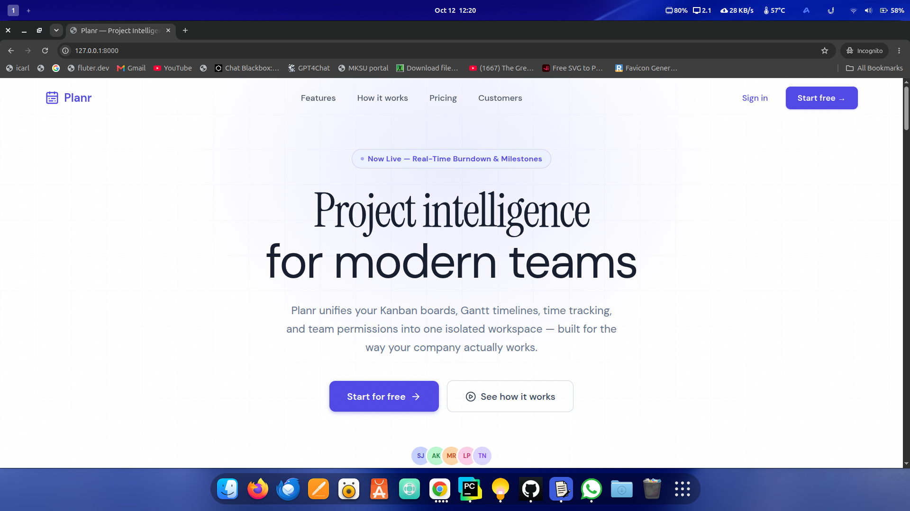
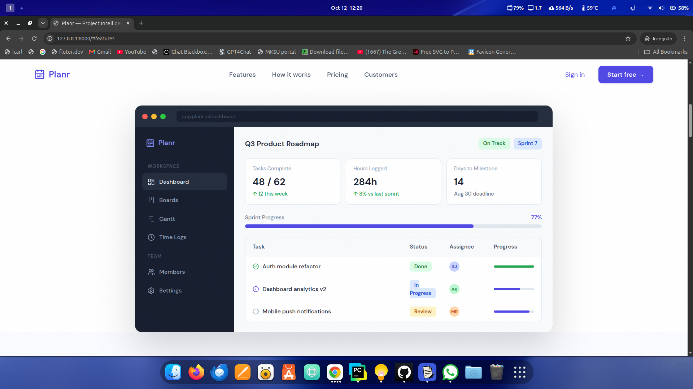
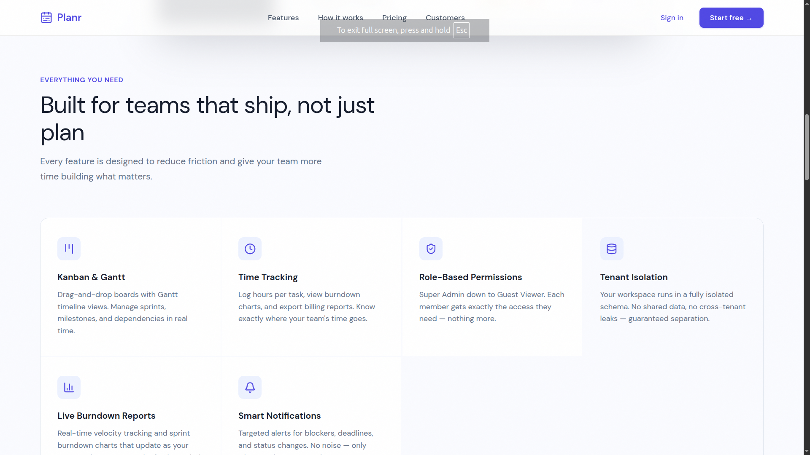

# Planr

A Django project management system with role-based access, organisation management and task tracking. Planr brings Kanban boards, timelines, time tracking and team permissions into one isolated workspace for each organisation.

## Screenshots


*Landing page*


*Dashboard preview: sprint progress, milestones and task status*


*Features: Kanban and Gantt, time tracking, role-based permissions and tenant isolation*

## Features

### Core
- **Authentication:** email-based login with email verification and password reset
- **Role-based access control:** Super Admin, Admin, Project Manager, Member and Viewer
- **Organisations:** create and manage organisations, each with a subscription package
- **Projects:** create projects inside an organisation, with configurable permissions
- **Tasks:** create, assign and track tasks with statuses, priorities and deadlines
- **Timelines and milestones:** project timelines with milestone tracking
- **Collaboration:** task comments and a status history for every task

### Advanced
- **Custom permission system:** octal-style read, write and execute permissions
  - The owner always keeps execute permission
  - Group and others permissions are configurable
  - Per-member execute overrides
  - Tasks can inherit or override project permissions
- **Subscription packages:** Free, Pro and Enterprise tiers with limits on members, projects and storage
- **Audit logging:** tracks organisation changes and user actions
- **Data model:** UUID primary keys and generic foreign keys for audit records

## Tech stack

- **Backend:** Django 6.0.5
- **Database:** SQLite for development, configurable for production
- **Authentication:** custom user model with email verification and token records
- **Frontend:** Django templates with Bootstrap and CSS
- **Other:** UUID primary keys, the ContentType framework and GenericForeignKey

## Project structure

```
Project-Managment-System/
├── authentication/    # Custom user model, login, registration, tokens
├── organization/      # Organisations, projects, tasks, permissions
├── planr/             # Django project settings and root URLs
├── docs/
│   └── screenshots/   # Images used in this README
├── manage.py
└── README.md
```

## Getting started

### Prerequisites
- Python 3.8 or newer
- pip
- A virtual environment tool such as venv

### Installation

1. Clone the repository
```bash
   git clone https://github.com/wayne-alex/Project-Managment-System.git
   cd Project-Managment-System
```

2. Create and activate a virtual environment
```bash
   python -m venv venv
   source venv/bin/activate    # Windows: venv\Scripts\activate
```

3. Install dependencies
```bash
   pip install -r requirements.txt
```
   If there is no `requirements.txt`, run `pip install django`.

4. Apply migrations
```bash
   python manage.py migrate
```

5. Create an admin user (optional)
```bash
   python manage.py createsuperuser
```

6. Start the server
```bash
   python manage.py runserver
```

7. Open http://127.0.0.1:8000/ in your browser. The admin panel is at http://127.0.0.1:8000/admin/

## Usage

1. Register an account, or log in with your admin credentials
2. Create an organisation and choose a subscription package
3. Invite team members
4. Create projects inside the organisation
5. Add tasks and assign them to members

## Permission system

Permissions use three octal digits, in this order: owner, group (project members), others (organisation members not in the project).

| Value | Meaning |
|---|---|
| 2 | Read: view task and project details |
| 4 | Write: change task statuses |
| 1 | Execute: change project structure, such as members and timeline |

Values add together. For example, `762` means:
- Owner: 7, read, write and execute
- Group: 6, read and write
- Others: 2, read only

## Subscription packages

| Package | Notes |
|---|---|
| Free | Limited members, projects and storage |
| Pro | Higher limits and extra features |
| Enterprise | Unlimited limits |

## Models overview

**Authentication app**
- `User`: custom user with email verification, roles and status
- `RefreshTokenRecord`: refresh token management
- `PasswordResetToken`: secure password reset
- `EmailVerificationToken`: email verification for new accounts

**Organization app**
- `SubscriptionPackage`: limits and features for each tier
- `Organization`: container for projects, with subscription and settings
- `OrganizationMember`: links users to organisations with a role
- `Project`: main work container with the custom permission system
- `ProjectMember`: project membership with permission overrides
- `Task`: work items with assignees, status, priority and permissions
- `ProjectTimeline`: milestones and phases
- `TaskComment`: discussion on tasks
- `TaskStatusHistory`: history of status changes
- `AuditLog`: organisation-wide activity log

## Contributing

1. Fork the repository
2. Create a branch: `git checkout -b feature/your-feature`
3. Commit your changes: `git commit -m "Add your feature"`
4. Push the branch: `git push origin feature/your-feature`
5. Open a pull request

## License

MIT License. See the LICENSE file for details.

## Author

Wayne Murunga: [GitHub](https://github.com/wayne-alex) · [LinkedIn](https://ke.linkedin.com/in/wayne-murunga-107886253)